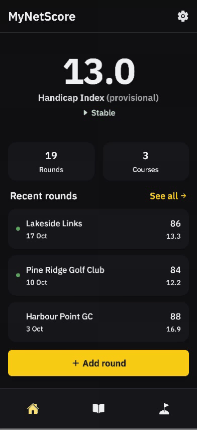

# MyNetScore

> **Offline-First Mobile Golf Handicap Calculator**  
> A hobby project built with **Angular 21**, **Tailwind CSS 4**, and **Dexie.js (IndexedDB)**, packaged as an installable Progressive Web App.

---

## Demo Preview

<div align="center">
  
</div>

> _Note: MyNetScore is designed exclusively for mobile screens. The demo above logs a 20th round on a saved course, which completes the WHS cycle and moves the index from provisional to official._

---

## Project Motivation & Context

MyNetScore is a hobby project and a follow-up to [PlaySudoku](https://github.com/r0h4dj1/playsudoku). It continues the same two threads, AI-assisted development and building mobile apps with web technologies, but this time with a focus on UI design. It had been a while since I'd designed a polished UI, and a golf handicap calculator felt like the right size of project: enough to take through an end-to-end AI-assisted mobile workflow, but simple enough that I could spend real time designing and polishing the interface.

The project served as a sandbox for:

1. **UI Design & Polish**: A dark, high-contrast theme built on brand design tokens, with large touch targets, bottom-sheet selectors, and a cascading course → tee flow designed for one-handed use outdoors.
2. **Web-to-Mobile with a PWA**: Delivering an installable, app-like experience on iOS and Android from a single Angular codebase, with all data stored on-device in IndexedDB.
3. **End-to-End AI-Assisted Development**: Taking the project from product and architecture docs through implementation, unit tests, and Cypress E2E tests with AI coding assistants throughout.

### Features

- **Living Index Dashboard**: The handicap index dominates the home screen, with a trend indicator (improving, worsening, stable) and provisional status.
- **Frictionless Round Logging**: Selecting a course filters its tees instantly; new courses and tees can be added inline without leaving the form.
- **Grow-As-You-Go Database**: Courses and tees are saved once and reused, making future rounds at the same venue near-instant to log.
- **Visual Round History**: Rounds counting toward the index are highlighted, with an "All rounds" / "Counting" filter and full edit/delete support.
- **Duplicate Detection**: Warns before logging a round that matches an existing one.
- **Regional Rules**: A settings toggle for Golf Australia's multiplier; everywhere else uses standard WHS maths.

**Not built (yet):** the [product doc](docs/PRODUCT.md) also describes a spark-line trend graph, a "What-If" calculator, shareable snapshot cards, and JSON/CSV export/import.

---

## Architecture Overview

```
┌────────────────────────────────────┐
│   Presentation (Angular 21 + TS)   │
│   - Standalone components, Signals │
│   - Tailwind CSS 4 design tokens   │
└─────────────────┬──────────────────┘
                  │
┌─────────────────▼──────────────────┐       ┌────────────────────────────┐
│   Business Logic (Services)        │       │   PWA Shell                │
│   - WHS engine (differentials,     │       │   - Web App Manifest       │
│     provisional table, 8-of-20)    │       │   - @angular/service-worker│
│   - Round, course & settings state │       │   - Offline asset caching  │
└─────────────────┬──────────────────┘       └────────────────────────────┘
                  │
┌─────────────────▼──────────────────┐
│   Data Access (Dexie.js)           │
│   - Courses → Tees → Rounds        │
│   - IndexedDB, on-device only      │
└────────────────────────────────────┘
```

- **Frontend**: Single-page Angular app using standalone components and Signals for reactive state, styled exclusively with Tailwind utility classes mapped to brand design tokens.
- **Business Logic**: `WhsService` encapsulates all handicap maths; page-level services derive the index, trend, and counting rounds from the stored history.
- **Storage**: A relational "Course → Tee → Round" model stored in IndexedDB via Dexie.js, with versioned schema migrations. Nothing leaves the device.

---

## Getting Started

### Prerequisites

- **Node.js** (v22+) & **npm**

### 1. Repository Setup

```bash
git clone https://github.com/r0h4dj1/mynetscore.git
cd mynetscore
npm install
```

### 2. Run the Dev Server

```bash
npm start
```

The app will run at `http://localhost:4200` and reload automatically on file changes. Use your browser's device toolbar (or a phone on the same network) for the intended mobile layout.

### 3. Production Build

```bash
npm run build
```

Outputs the installable PWA to `dist/`.

---

## Testing & Code Quality

### Unit Tests (Vitest)

```bash
npm test                  # Run the unit test suite
```

### E2E Tests (Cypress)

```bash
npm run e2e               # Headless run
npm run e2e:open          # Interactive runner
```

The Cypress suite drives the real app against the live IndexedDB layer (no mocks). Both commands use `start-server-and-test` to boot the dev server, wait for `http://localhost:4200`, run the specs, then shut the server down, so you do **not** need a separate `npm start` running.

The specs seed, reset, and read the database through a `window.__APP_DB__` bridge that `src/main.ts` exposes only when `isDevMode()` is true. It is never included in production builds, so E2E tests must run against the dev server.

### Linting & Formatting (ESLint & Prettier)

```bash
npm run lint              # Run ESLint
npm run lint:fix          # Auto-fix lint issues
npm run format            # Format with Prettier
```

---

## Documentation

- [Product Overview](docs/PRODUCT.md): vision, features, target audience
- [System Architecture](docs/ARCHITECTURE.md): tech stack, data model, WHS engine
- [Contributing Guidelines](docs/CONTRIBUTING.md): coding standards and testing strategy (internal only; external contributions are not accepted)
